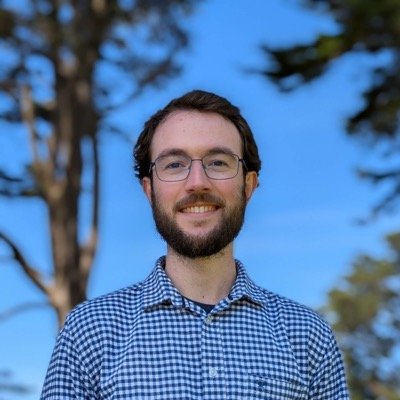

<link rel="preload" href="img/headshot-sm.jpg" as="image" type="image/jpeg">

::::: {style="display: flex; flex-direction: row; flex-wrap: wrap; gap: 20px;"}

:::: {.home-left style="flex: 1; text-align: center; padding: 70px 10px 0 10px;"}

::: home-photo
{fig-alt="photo" width=200 height=200}
:::

# Ellis Cain, Ph.D. {.unnumbered .unlisted}

`cain1@kenyon.edu`

::: home-links
[](https://scholar.google.com/citations?hl=en&user=AMsKqKQAAAAJ){aria-label="Google Scholar"}
[<i class="bi bi-github"></i>](https://github.com/ellissc){aria-label="GitHub"}
[<i class="bi bi-bluesky"></i>](https://bsky.app/profile/ellscain.bsky.social){aria-label="Bluesky"}
:::

::::

:::: {.home-right style="flex: 2; text-align: left; padding: 50px 10px 0 10px;"}

### About

I am a Postdoctoral Fellow in the [Interdisciplinary Program in Computing program](https://www.kenyon.edu/academics/departments-and-majors/computing/) at Kenyon College.

How do we learn and change across a lifespan? How does what individuals learn during their lifespan relate to what is passed down across generations? I study the relationship among language adaptation in the moment, cognitive development across the lifespan, and cultural transmission across generations. My work combines online and in-person behavioral experiments, computational modeling, and large-scale corpora analysis to better understand how individual minds both shape and are shaped by the broader communities that they belong to.

---

### Areas of Study

- Lifespan Learning 
- Aging and Cognitive Development
- Psychology of Language
- Cultural Transmission and Evolution

::::

:::::
